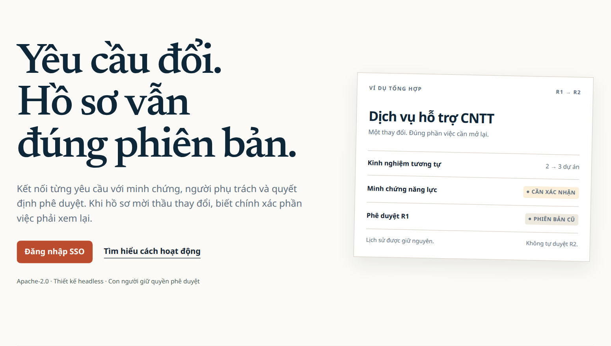
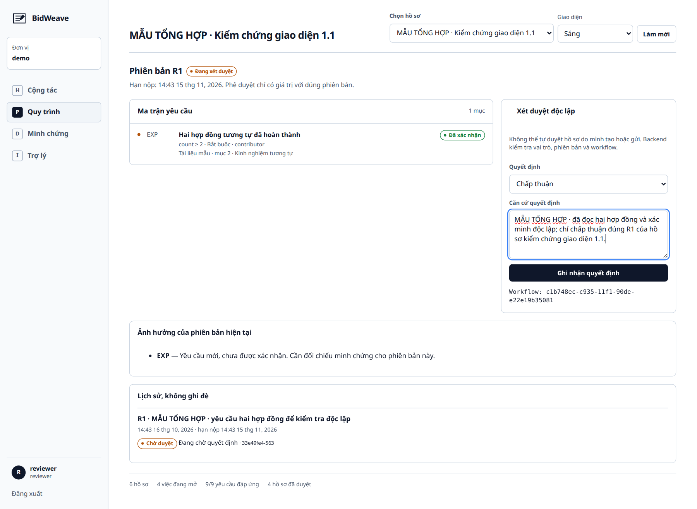

<!-- SPDX-FileCopyrightText: 2026 BidWeave contributors -->
<!-- SPDX-License-Identifier: Apache-2.0 -->

<div align="center">

# BidWeave

**Yêu cầu đổi. Hồ sơ vẫn đúng phiên bản.**

[](https://github.com/EngLandLee/BidWeave/actions/workflows/ci.yml)
[](https://github.com/EngLandLee/BidWeave/actions/workflows/pages.yml)
[](LICENSE)
[](https://github.com/EngLandLee/BidWeave/releases)

[Giới thiệu](https://englandlee.github.io/BidWeave/) · [Chạy từ nguồn](#chạy-cục-bộ) · [Tài liệu API](docs/api.md) · [Hướng dẫn sử dụng](docs/user-guide.md) · [Kiến trúc](docs/architecture.md) · [Báo lỗi](https://github.com/EngLandLee/BidWeave/issues/new/choose)

</div>



## Bài toán

Đội chuẩn bị hồ sơ dự thầu có yêu cầu, minh chứng, người phụ trách và phê duyệt nằm rải rác. Khi bên mời thầu đổi **hai hợp đồng tương tự thành ba**, hoặc thay hạn nộp, một dấu “đã duyệt” cũ không còn đủ.

BidWeave nối **yêu cầu → minh chứng → công việc → người xác minh → quyết định đúng phiên bản**. Sửa đổi tạo revision mới, giữ lịch sử, chỉ ra ràng buộc thay đổi và yêu cầu xác nhận lại. Người dùng không thể xuất một revision cũ như thể đó là hồ sơ hiện hành đã được duyệt.

Không phải hệ thống đấu thầu quốc gia, công cụ chấm thầu tự động hay lời hứa trúng thầu. Metadata TED là nguồn công khai để liên kết và đối chiếu, không chứng minh nội dung minh chứng do người dùng nộp.

## Điểm riêng của dự án

- **Sửa đổi có tác động:** thay ngưỡng, loại yêu cầu, nội dung, nguồn hoặc hạn nộp được ghi thành ảnh hưởng và công việc; không ghi đè revision trước.
- **Xác minh độc lập:** tách người tải tài liệu, người xác nhận minh chứng, người gửi và người phê duyệt. Hoàn thành task không tự biến thành đạt yêu cầu.
- **Quyết định gắn phiên bản:** kiểm tra revision ở backend, quy trình duyệt chạy thật trên Flowable, có nhánh yêu cầu sửa và gửi lại.
- **Gói xuất kiểm tra được:** `.tar.gz` chứa minh chứng và manifest SHA-256, chỉ cho revision hiện hành đã phê duyệt; không phải chữ ký số pháp lý.
- **Linked data có nguồn:** truy vấn RDF TED, giữ URI/source graph/thời điểm thu thập, xuất JSON-LD và ghi named graph riêng vào Fuseki. Không công khai đồ thị nội bộ.
- **Agent có giới hạn:** LLM cục bộ đề xuất, trích xuất bản nháp và dẫn nguồn; MCP dùng danh tính người gọi. Không có công cụ Agent tự duyệt hồ sơ.

## H–P–D–I trong một workspace

| Không gian | Công việc thực hiện |
| --- | --- |
| **H — Human** | Nhận việc, cập nhật nhiệm vụ, trao đổi, bàn giao và biên nhận đồng bộ |
| **P — Process** | Soạn revision, xem thay đổi, gửi Flowable, phê duyệt/yêu cầu sửa, giữ lịch sử |
| **D — Data** | Tải và xác minh tệp, kiểm tra SHA-256, tra TED, xem JSON-LD, snapshot lịch sử, tìm yêu cầu và kiểm tra chuỗi audit |
| **I — Intelligence** | Hỏi theo ngữ cảnh hồ sơ, trích xuất PDF/text thành đề xuất, rà soát trước khi lưu và dùng MCP theo quyền |



[Ảnh và kịch bản thao tác từng bước](docs/user-guide.md) được chụp từ hệ thống cục bộ đang chạy, với dữ liệu tổng hợp được ghi rõ. Workspace và Keycloak có giao diện sáng/tối; landing công khai giữ nguyên. Không dùng mockup thay bằng chứng chạy.

## Ba tầng, bảy lớp

| Tầng | Triển khai |
| --- | --- |
| **1 — Lõi headless** | Keycloak SSO; APISIX gateway; PostgreSQL + SeaweedFS; Flowable workflow; dịch vụ dữ liệu/sự kiện/quan sát dùng chung |
| **2 — Không gian năng lực** | Workspace H–P–D–I, SSO, giao diện kiểm tra và thao tác có quyền; chat là một lối vào, không phải toàn bộ sản phẩm |
| **3 — Nghiệp vụ** | Mô hình hồ sơ dự thầu, requirements/revisions/evidence, tác động sửa đổi, quy tắc độc lập và xuất gói |

Bảy lớp được đối chiếu đầy đủ trong [kiến trúc](docs/architecture.md): trải nghiệm; biên mạng/an toàn; logic/trạng thái; workflow/DevSecOps; lưu trữ/sự kiện/kiểm toán; phân tích/AI; quản trị/tìm kiếm/giám sát. **Không đồng nhất bảy lớp với bảy container, và không tuyên bố đã triển khai mọi sản phẩm tham chiếu của đề.**

## Chạy cục bộ

Cần Docker Engine + Compose v2, Git, GNU Make, Python 3.12/3.13 và [uv](https://docs.astral.sh/uv/getting-started/installation/). Khuyến nghị 16 GB RAM cho đầy đủ profile; lần đầu cần Internet để tải dependency, dữ liệu ClamAV và model.

```bash
git clone https://github.com/EngLandLee/BidWeave.git
cd BidWeave
make demo
```

Mở **<http://localhost:8090>**. Lấy `DEMO_PASSWORD` từ tệp `.env` vừa sinh trên máy, đăng nhập `coordinator`, `contributor` hoặc `reviewer`. `outsider` thuộc tenant khác để kiểm tra cách ly. Không đưa `.env` hoặc mật khẩu vào issue, ảnh hay Git.

`make demo` build mã dự án, chạy lõi cùng các profile, tải `qwen2.5:1.5b` và publish workflow n8n. Nếu chỉ cần bốn dịch vụ lõi và workspace, dùng `make up` thay vì `make demo`.

```bash
make health
make smoke          # SSO → gateway → dữ liệu → workflow → sửa đổi → xuất
make intelligence   # SDK MCP và model thật, sau make smoke
make test
make headers
make down           # Dừng; không xóa volume
```

Xem [vận hành, tài khoản, backup/restore và xử lý lỗi](docs/operations.md). **GitHub Pages chỉ là landing tĩnh**; không chứa tài khoản, SSO hoặc API công khai. Compose mặc định dành cho localhost, không tự động trở thành cấu hình production.

## Luồng trình diễn

1. `coordinator` tạo hồ sơ và R1: cần hai hợp đồng tương tự.
2. Nạp minh chứng tổng hợp; `reviewer` xác minh độc lập.
3. `coordinator` gửi duyệt; `reviewer` chấp thuận R1; xuất gói kiểm tra manifest.
4. Tạo R2: ngưỡng tăng lên ba. R1 vẫn còn trong lịch sử, nhưng không được xuất như bản hiện hành; R2 chưa đủ điều kiện duyệt.
5. Bổ sung hợp đồng thứ ba, xác minh lại theo R2, gửi duyệt và chấp thuận R2.
6. Tra metadata TED, xem liên kết JSON-LD/Fuseki và snapshot DuckDB/Parquet; gọi n8n ghi biên nhận đúng revision.
7. Hỏi Agent vì sao cần xem lại; kiểm tra nguồn và các công cụ MCP không có quyền phê duyệt.

Tệp mẫu nằm trong `data/examples/`. Đây là dữ liệu tổng hợp, không phải hợp đồng thật. [Hướng dẫn màn hình](docs/user-guide.md) và [bằng chứng kiểm chứng](docs/verification.md) phân biệt rõ phần đã chạy với giới hạn còn lại.

## Mã tự viết và thành phần tích hợp

**Đội phát triển:** domain yêu cầu–minh chứng–revision, quy tắc kiểm tra, impact/task, API, workspace, adapter workflow/SSO/storage, công cụ MCP, prompt/schema ràng buộc, truy vấn/projection linked data, script build/backup/release và cấu hình tích hợp.

**Không tự nhận là mã của đội:** Keycloak, APISIX, PostgreSQL, Flowable, SeaweedFS, ClamAV, NATS, Jena, DuckDB, Ollama, model Qwen, n8n, OTel, Prometheus, React, font và metadata TED. [Bảng giấy phép có nguồn dẫn](docs/licensing.md) tách từng nhóm.

**Lưu ý n8n:** bản Community dùng Sustainable Use License, không phải OSI-approved. Nó là connector tùy chọn, không thay Flowable trong lõi bắt buộc. Tách dịch vụ không tự động bảo đảm được chấp nhận ở mọi cách chấm giấy phép. Người nộp cần trình bày ranh giới này minh bạch; không có cam kết điểm tối đa.

## Tổ chức repository

```text
apps/web/                 Landing và workspace H–P–D–I
services/api/              Domain, API, dữ liệu liên kết, audit và outbox
services/workflow/         Flowable chạy headless, cấu hình BPMN
services/mcp/              Công cụ MCP dùng danh tính người gọi
infra/                    Cấu hình các dịch vụ lõi và quan sát
integrations/             Workflow n8n và hướng dẫn TED/MCP
scripts/                  Configure, smoke, backup, kiểm tra header, release/SBOM
data/                     Dữ liệu tổng hợp có ghi nguồn/giấy phép
docs/                     Kiến trúc, sử dụng, vận hành, kiểm chứng, giấy phép
.github/                  CI, Pages, release, issue forms, PR, CODEOWNERS
```

## Phát triển công khai và hồ sơ PoF

- [Issue tracker](https://github.com/EngLandLee/BidWeave/issues): `status:research` → `status:in-progress` → `status:review` → `status:done`; milestone phát hành và PR liên kết.
- Nhánh `feature/*` → PR vào `develop` → PR phát hành vào `main`; không giả lập người review hay lịch sử đóng góp.
- CI kiểm tra header/REUSE, hành vi API, build frontend và Flowable từ nguồn. [Release](https://github.com/EngLandLee/BidWeave/releases) có tarball nguồn, SPDX/inventory và checksum.
- [Đối chiếu đề/thể lệ](docs/contest.md), [CONTRIBUTING](CONTRIBUTING.md), [SECURITY](SECURITY.md), [CHANGELOG](CHANGELOG.md), [quy trình release](docs/release.md).

## Giấy phép

Mã gốc của BidWeave: **[Apache-2.0](LICENSE)**. Source header dùng SPDX; JSON, ảnh và một số tệp sinh tự động có `.license` đi kèm. Không gắn Apache-2.0 thay cho giấy phép của sản phẩm tích hợp, model, font hoặc dữ liệu bên ngoài. Xem [NOTICE](NOTICE) và [chính sách giấy phép](docs/licensing.md).
