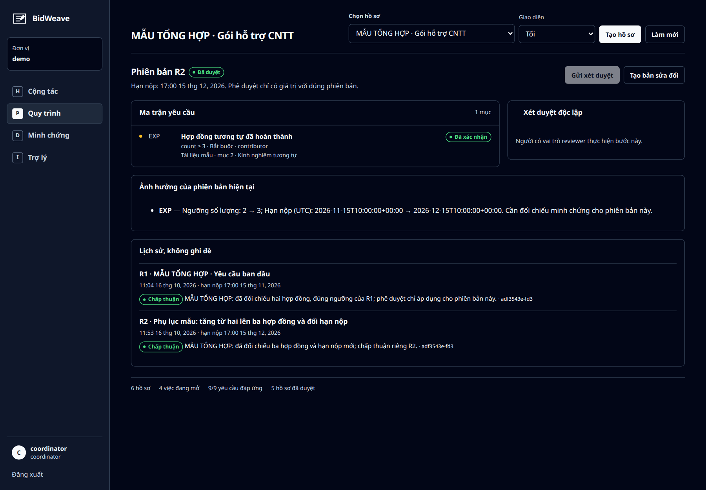
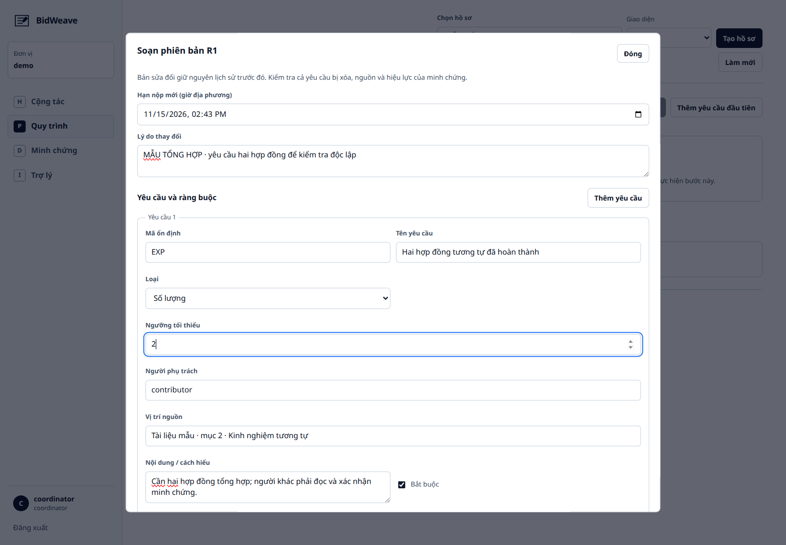
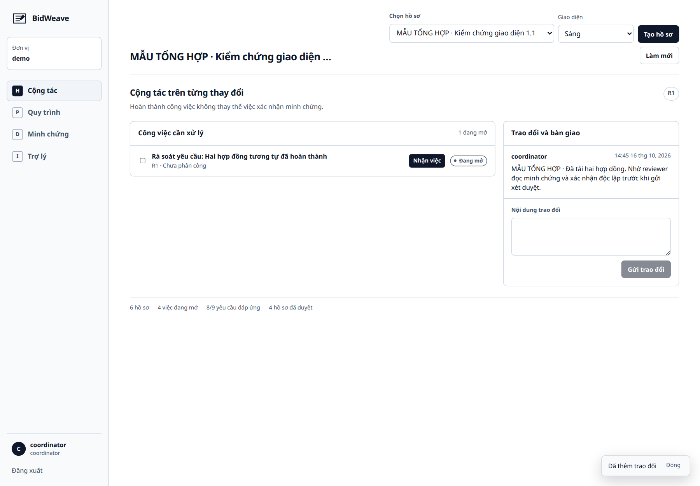
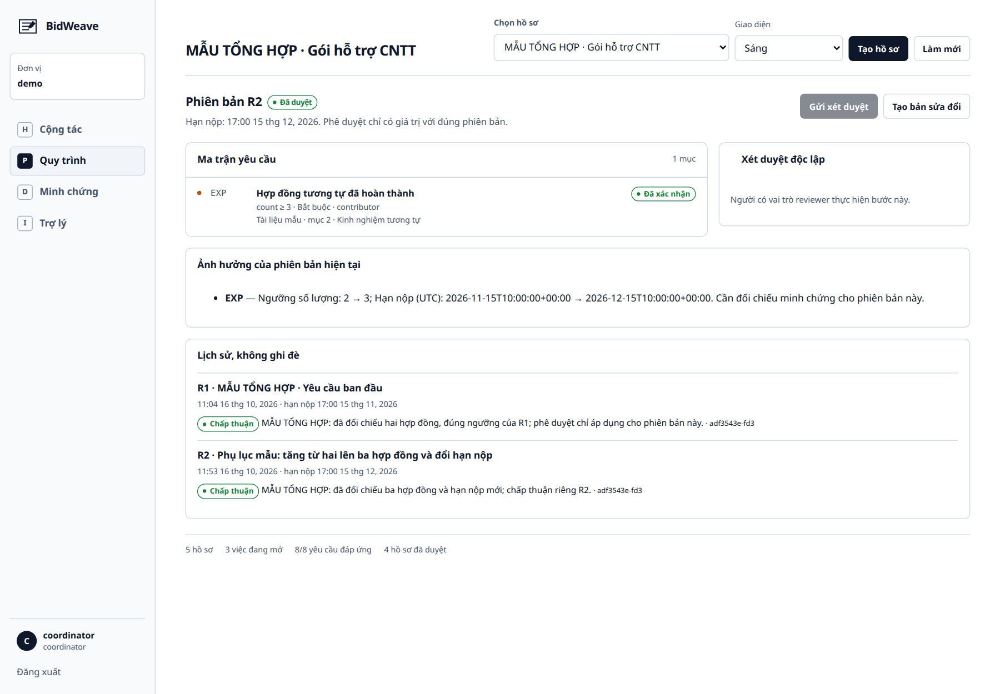
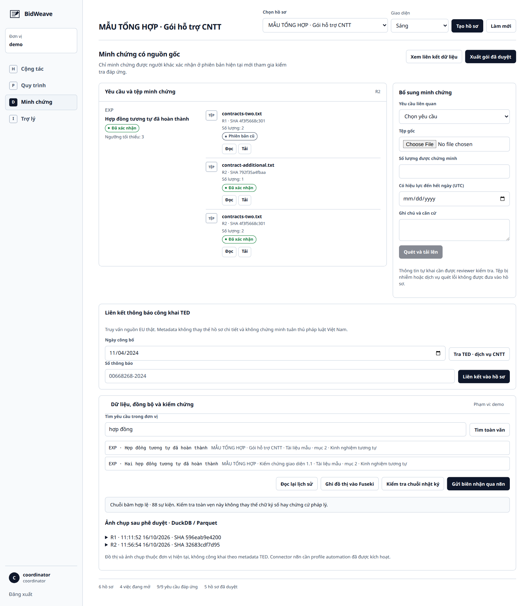
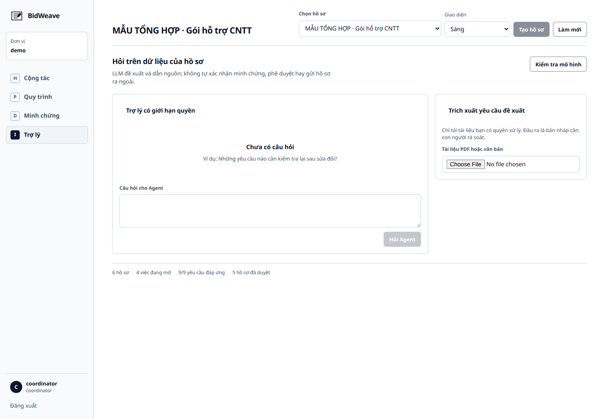
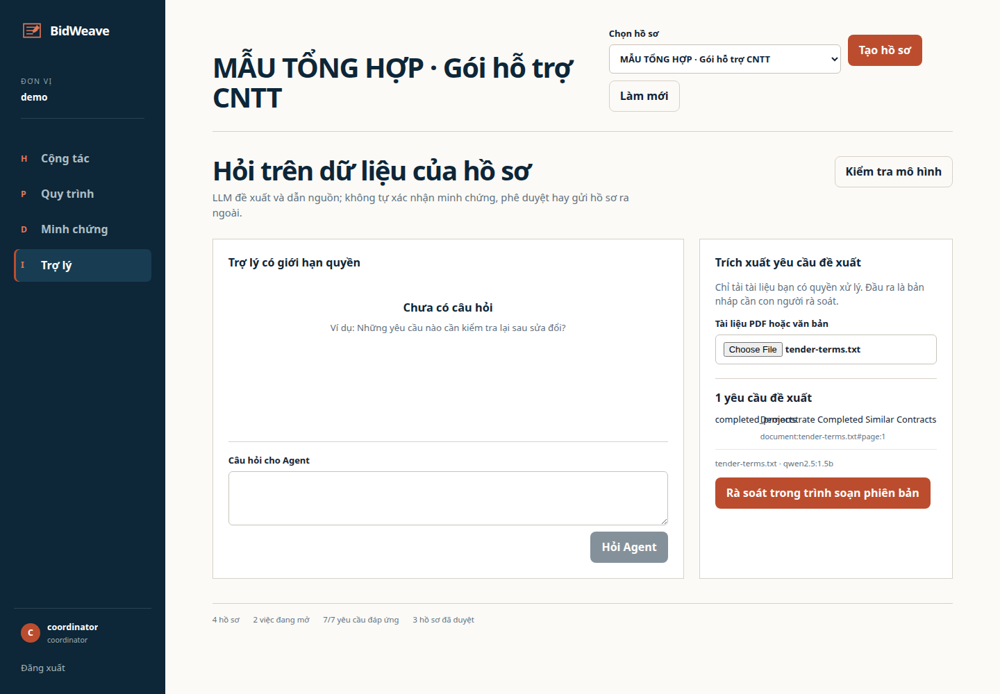
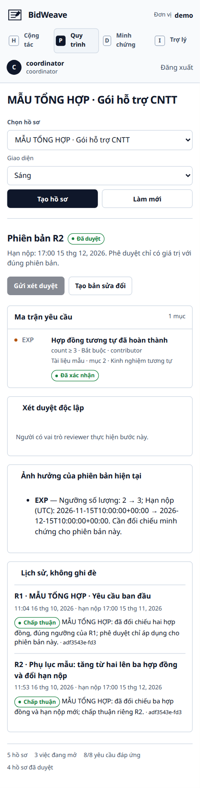

<!-- SPDX-FileCopyrightText: 2026 BidWeave contributors -->
<!-- SPDX-License-Identifier: Apache-2.0 -->

# Hướng dẫn sử dụng và luồng demo

Các ảnh trong tài liệu được chụp bằng trình duyệt tự động từ BidWeave đang chạy, không phải bản thiết kế. Ảnh workspace và đăng nhập trong `images/ui-1.1/` thuộc giao diện 1.1; ảnh kết quả Agent/trích xuất cũ được ghi rõ là kiểm chứng 1.0. Hồ sơ, hợp đồng và trao đổi được ghi **MẪU TỔNG HỢP**; metadata TED được truy vấn từ nguồn công khai thật. Không nhập tài liệu hoặc dữ liệu cá nhân thật vào một buổi trình diễn công khai.

## 1. Khởi động và đăng nhập

Thực hiện [hướng dẫn vận hành](operations.md), chạy `make demo`, mở <http://localhost:8090> và chọn **Đăng nhập SSO**. Mật khẩu mẫu nằm trong `.env` riêng trên máy; không sao chép vào slide/issue. Đăng nhập `coordinator`.

Landing công khai giải thích sản phẩm; GitHub Pages chỉ chứa trang này, không chứa backend. [Ảnh landing đầy đủ](images/landing.png).

### Giao diện sáng, tối và đăng nhập

Workspace dùng thanh H–P–D–I, bộ chọn hồ sơ và bộ chọn **Giao diện** ở phần đầu. Chọn **Sáng**, **Tối** hoặc **Theo hệ thống**; lựa chọn được nhớ trên trình duyệt. Trang Keycloak cùng hostname nhận lựa chọn qua cookie giao diện không chứa thông tin đăng nhập. Khi triển khai hai hostname khác nhau, không giả định lựa chọn tự đồng bộ.

Theme Keycloak chỉ đổi cách trình bày; danh tính, quyền và mật khẩu vẫn do Keycloak quản lý. Realm hiện có giữ ngôn ngữ đã cấu hình; realm mới do dự án tạo mặc định tiếng Việt.

[Đăng nhập sáng](images/ui-1.1/login-light-desktop.png) · [Đăng nhập tối](images/ui-1.1/login-desktop.png) · [Đăng nhập mobile](images/ui-1.1/login-mobile.png)

## 2. Tạo hồ sơ và yêu cầu R1

1. Chọn **Tạo hồ sơ**. Đặt tên có nhãn mẫu, ví dụ `MẪU TỔNG HỢP · Gói hỗ trợ CNTT`.
2. Đặt hạn nộp **trong tương lai**, ví dụ sau ngày demo 30 ngày. Hồ sơ mới có revision 0.
3. Trong **P — Quy trình**, chọn **Thêm yêu cầu đầu tiên**.
4. Ghi lý do `Yêu cầu ban đầu`, thêm một yêu cầu:

| Trường | Giá trị mẫu |
| --- | --- |
| Mã ổn định | `EXP` |
| Tên | `Hợp đồng tương tự đã hoàn thành` |
| Loại | `Số lượng` |
| Ngưỡng tối thiểu | `2` |
| Người phụ trách | `contributor` |
| Vị trí nguồn | `Tài liệu mẫu · mục 2 · Kinh nghiệm tương tự` |
| Nội dung | Phải có ít nhất hai hợp đồng hoàn thành kèm minh chứng |
| Bắt buộc | Có |

5. Chọn **Lưu phiên bản**. Đây là R1; không có dấu xác nhận tự động.

Mã `EXP` là định danh để so sánh giữa các revision, không nên đổi chỉ vì sửa tiêu đề. Trường người phụ trách là mô tả nghiệp vụ; không cấp vai trò SSO hay tự nhận task thay người dùng.

## 3. Cộng tác và liên kết nguồn mở

Trong **H — Cộng tác**, dùng **Nhận việc**, hoàn thành task và gửi trao đổi/bàn giao. Đánh dấu task hoàn thành **không thay** việc xác minh minh chứng hoặc phê duyệt hồ sơ.

Trong **D — Minh chứng**, khi hồ sơ còn là bản nháp:

- Chọn ngày công bố `2024-11-04`, bấm **Tra TED · dịch vụ CNTT**.
- Đọc publication number, CPV và source graph; có thể chọn `00668268-2024` nếu nguồn còn trả bản ghi này.
- Nhập số thông báo rồi **Liên kết vào hồ sơ**. Bản đã duyệt không được sửa metadata bằng thao tác này.

Đây là minh họa nối định danh và provenance, **không khẳng định hồ sơ tổng hợp đang tham gia thông báo TED đó**. Khi nguồn ngoài lỗi, ứng dụng báo lỗi; không thay bằng kết quả giả.

## 4. Tải và xác minh minh chứng

1. Đăng xuất, đăng nhập `contributor` (coordinator cũng có thể tải trong demo).
2. Chọn đúng hồ sơ, mở **D**, chọn yêu cầu `EXP`.
3. Tải `data/examples/contracts-two.txt`, điền số lượng `2`, thêm ghi chú đây là dữ liệu tổng hợp, chọn **Quét và tải lên**.
4. Tệp đi qua ClamAV trước khi được lưu; bảng hiện filename, revision và SHA-256. Tải thành công **chưa đồng nghĩa đã được xác minh**.
5. Đăng xuất, đăng nhập `reviewer`, mở hồ sơ trong **D**, chọn **Đọc** để xem nội dung mẫu hoặc **Tải**, rồi **Xác nhận**.

Không dùng số lượng tự khai như sự thật ngoài đời. Reviewer phải đối chiếu nội dung và căn cứ. Tải hai bản cùng byte không nhân đôi số lượng được tính.

## 5. Phê duyệt R1

1. `coordinator` mở **P**, chọn **Gửi xét duyệt**. Nếu thiếu minh chứng hợp lệ, API từ chối.
2. `reviewer` mở **P**, chọn **Chấp thuận**, ghi căn cứ và **Ghi nhận quyết định**.
3. Có thể chọn **Yêu cầu sửa** để đưa hồ sơ về bản nháp; sau bổ sung, coordinator gửi lại bằng workflow mới.
4. Khi R1 đã duyệt, **D → Xuất gói đã duyệt** tải `.tar.gz` chứa tệp và `manifest.json`. So sánh SHA-256 của tệp với manifest.

Phê duyệt là quyết định của người dùng trong workflow, không phải sự chứng nhận pháp lý từ phần mềm. [Ảnh xét duyệt độc lập trên giao diện 1.1](images/ui-1.1/independent-review-desktop.png).

## 6. Sửa đổi R2: hai hợp đồng thành ba

1. `coordinator` chọn **P → Tạo bản sửa đổi**.
2. Giữ mã `EXP`, đổi ngưỡng `2` thành `3`, chọn hạn nộp mới trong tương lai, ghi lý do và lưu.
3. Xem phần **Ảnh hưởng của phiên bản hiện tại**: nêu giá trị trước/sau và hạn nộp trước/sau. R1 cùng quyết định cũ vẫn nằm trong lịch sử.
4. R2 trở về bản nháp. Minh chứng/duyệt R1 không tự trở thành xác nhận/duyệt R2. Nút xuất chưa được mở; gọi API xuất revision cũ hoặc R2 chưa duyệt cũng bị chặn.

5. Tải `data/examples/contract-additional.txt` với số lượng `1` cho R2.
6. `reviewer` chọn **Xác nhận lại** ở minh chứng hai hợp đồng của R1 và **Xác nhận** ở tệp mới. Bản ghi xác nhận R1 vẫn được giữ; có bản ghi tương ứng cho R2.
7. `coordinator` gửi xét duyệt R2, `reviewer` chấp thuận với căn cứ mới. Xuất lại gói R2 và kiểm tra manifest.

[Ảnh R2 đã duyệt, giữ nguyên lịch sử R1](images/ui-1.1/process-desktop-light.png).

## 7. Dữ liệu, audit và n8n

Tab **D** có các thao tác dùng dịch vụ thật:

- **Tìm toàn văn:** nhập `hợp đồng`, nhận yêu cầu hiện hành trong tenant; chọn kết quả để mở hồ sơ.
- **Xem liên kết dữ liệu:** JSON-LD của hồ sơ đang được phép đọc.
- **Ghi đồ thị vào Fuseki:** coordinator cập nhật named graph riêng. Đây là thao tác publish vào kho nội bộ, không xuất bản hồ sơ lên Internet.
- **Đọc lại lịch sử:** snapshot sau phê duyệt được truy vấn bằng DuckDB/Parquet. Có thể trễ ngắn so với giao dịch do worker xử lý sự kiện.
- **Kiểm tra chuỗi nhật ký:** kiểm tra hash/liên kết. Kết quả hợp lệ không thay chữ ký số hoặc checkpoint tin cậy độc lập.
- **Gửi biên nhận qua n8n:** chỉ coordinator, đúng revision đã duyệt. Sau thành công, tab H thấy comment mới **không cần bấm Làm mới**. Nếu revision đổi trước bước ghi, API từ chối biên nhận cũ.

n8n không tự phê duyệt, không giả vờ đã gửi email/nộp thầu; xem [phạm vi và giấy phép connector](../integrations/n8n-setup.md).

## 8. Agent và trích xuất có rà soát

Trong **I — Trợ lý**:

- Có thể **Kiểm tra mô hình**.
- Hỏi: `Revision hiện tại là gì? Hồ sơ đã được duyệt chưa? Nêu nguồn để tôi đối chiếu.`
- Kiểm tra câu trả lời, source ID, model và giới hạn. Chat nhận metadata có quyền, không tự nhận xét rằng đã đọc toàn văn tất cả minh chứng.

[Ảnh câu trả lời thật từ lần kiểm chứng 1.0](images/agent-grounded-answer.png) được giữ làm bằng chứng lịch sử, không phải ảnh giao diện mới. Trong lượt kiểm chứng giao diện 1.1, Ollama báo thiếu RAM và workspace hiển thị lỗi provider; không ghi nhận lượt đó là AI thành công.

Để trích xuất, tải `data/examples/tender-terms.txt` hoặc PDF có text mà bạn có quyền xử lý. File mẫu có yêu cầu hai hợp đồng. Kết quả phải được người dùng kiểm tra, đặc biệt key, loại `count`, ngưỡng `2`, nguồn và người phụ trách.

Chọn **Rà soát trong trình soạn phiên bản**, sau đó **Rà soát đề xuất** trong tab P để mở editor. Việc này **chưa lưu revision**. Nếu đang minh họa R2 đã duyệt và không muốn sửa tiếp, đóng editor, không chọn lưu. Khi thực sự dùng đề xuất, phải hợp nhất với các yêu cầu hiện có: không vô tình xóa các yêu cầu chỉ vì chúng không xuất hiện trong đoạn tài liệu vừa trích xuất.

Model nhỏ có thể diễn đạt chưa tự nhiên, thiếu hoặc hiểu sai yêu cầu. Trích xuất scan không có text cần OCR trước. Không xem đầu ra JSON hợp lệ hoặc có source ID là bằng chứng mọi kết luận đều đúng.

Client Agent ngoài workspace có thể dùng [MCP](../integrations/MCP.md), nhưng phải cấp token riêng và vẫn chịu cùng quyền API. Không có công cụ tự phê duyệt.

## 9. Màn hình nhỏ và các tình huống chặn

Đã kiểm tra viewport 390 pixel không có tràn ngang. Các panel xuống một cột; thanh H–P–D–I vẫn dùng được. Đây không phải chứng nhận mọi thiết bị/trình đọc màn hình đều đã được kiểm thử.

| Tình huống | Hành vi mong đợi |
| --- | --- |
| Hạn nộp quá khứ hoặc key yêu cầu trùng | Không tạo revision; lỗi xuất hiện và nhận focus ngay trong hộp thoại |
| Hai người cùng sửa từ revision cũ | 409; tải lại và đối chiếu, không tự ghi đè |
| Người tải tự xác nhận hoặc người gửi tự duyệt | API từ chối dù cố gọi ngoài UI |
| `outsider` đọc hồ sơ tenant chính | 404; không tiết lộ dữ liệu |
| Model/TED/Fuseki/n8n chưa bật hoặc lỗi | Lỗi rõ ràng, không hiển thị thành công giả |
| Giao diện giữ dữ liệu cũ sau thao tác từ nơi khác | **Làm mới**, kiểm tra revision trước khi tiếp tục |

[Ảnh lỗi hạn nộp trong dialog mobile](images/ui-1.1/revision-error-mobile.png). Người dùng có thể sửa dữ liệu tại chỗ; không phải đóng dialog để đọc lỗi.

Đối chiếu các kiểm chứng đã thực hiện tại [verification.md](verification.md), không suy ra rằng mọi giới hạn triển khai thật đã được giải quyết chỉ từ ảnh demo.
